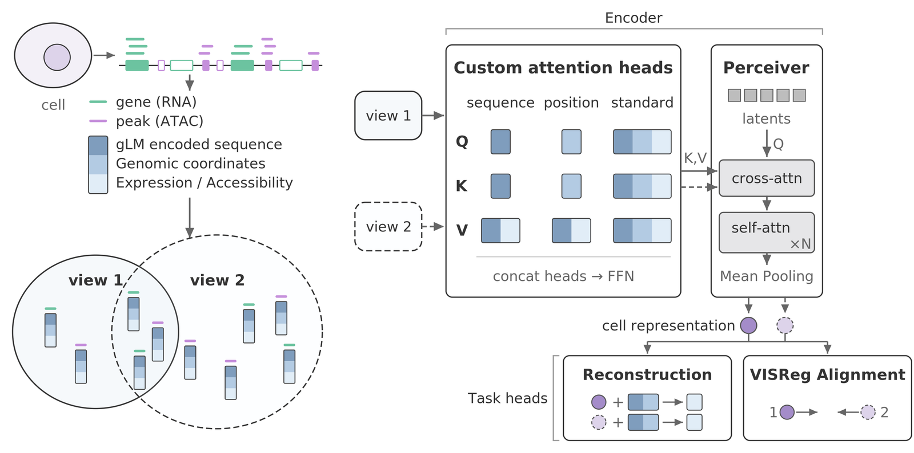

# *Bloom* unifies brain cell representations across modalities and contexts

Rohan Gala‡, Ian Convy‡, Yeganeh Marghi‡, Ruiyang Liu, Jeremy Roghair, Renhao Xue, Nathan Gouwens, Sven Otto, Samantha Caldwell,
Krutika Khinvasara, Jon Martin, Sudipta Sengupta, Zizhen Yao, Michael Hawrylycz, Shoaib Mufti, Hongkui Zeng, Uygar Sümbül
‡ equal contribution

bioRxiv 2026 — <https://www.biorxiv.org/content/10.64898/2026.11.11.765881> — doi:[10.64898/2026.11.11.765881](https://doi.org/10.64898/2026.11.11.765881)

`bloom-biorxiv` is the inference-only companion repository of the preprint:
a multimodal single-cell transformer trained on mouse brain RNA and ATAC data. `bloom` takes an
AnnData per modality (RNA and/or ATAC), maps features onto the `mm10-evo2-v1` reference tables,
and writes 1024-d cell embeddings (`obsm["X_bloom_rna"]`, `obsm["X_bloom_atac"]`) with the released
model `hyacinth`. It also exposes the model as a plain `torch.nn.Module` (attention Q/K, token states,
Perceiver latents) for ML users. Training code is not included; it lives in `alleninstitute/bloom`.

> **v0.1.0** (2026-11-14) — first public inference release: RNA **and ATAC** end-to-end on CPU or GPU (`bloom download`,
> `bloom prepare`, `bloom embed --rna/--atac`, `bloom info`) and the ML internals API (`encode(return_internals=True)`,
> `pair_logits`, `capture`, custom `ViewStrategy`; [docs/internals.md](docs/internals.md)). Changes: [CHANGELOG.md](CHANGELOG.md);
> what is next: [ROADMAP.md](ROADMAP.md).



*Bloom architecture.* Left: a cell's expressed genes and accessible peaks are encoded as tokens from the gLM-encoded sequence,
the genomic coordinates and the measured expression / accessibility, and views are sampled from the detected features. Right:
the tokens pass through sequence-, position- and standard attention heads and an FFN, a Perceiver cross-attends them into
latents, N self-attention layers and mean pooling give the cell representation; the reconstruction and alignment heads are
training-time task heads (the released model is inference-only).

## Quickstart

Every command below runs from a fresh clone on any machine with conda and an internet connection; nothing depends
on a particular host. Measured walls and parity numbers for each step: [docs/validation.md](docs/validation.md).

```bash
git clone https://github.com/alleninstitute/bloom-biorxiv.git && cd bloom-biorxiv
scripts/setup_env.sh bloom-biorxiv cpu        # or `cu128` for CUDA 12.8: conda env + torch + `pip install -e .[dev]` (~2 min)
# The script does NOT activate the env; its last line prints the prefix. Either put <prefix>/bin on PATH or
# call the binaries by full path:
export PATH=<prefix>/bin:$PATH
bloom info                                    # versions, device, BLOOM_HOME (~/.cache/bloom), asset status

# 1. assets: model weights (497 MB) + gene table (99 MB) into BLOOM_HOME, sha256-verified, from the public
#    bucket https://bloom-biorxiv.s3.us-west-2.amazonaws.com/ (anonymous; resumable; docs/assets.md section 2)
bloom download --what model,genes
# optional: `--what orthologs` (human input), `panels` (hvg_1999 genes, da_2127 peaks), `examples` (20-cell RNA + ATAC
#           fixture with reference embeddings, 8 MB), `peaks` (5.4 GB, needed for --atac)

# 2. embed the committed 100-cell fixture (mouse, log1p-CPM + counts layer) on CPU
bloom embed --rna tests/data/rna_100.h5ad --species mouse -o embeddings.h5ad            # paper default: random (4 random draws of up to 8192 detected genes)
bloom embed --rna tests/data/rna_100.h5ad --species mouse --strategy top -o emb_top.h5ad   # deterministic, 1 view, lmax 4096 (45 s on 16 CPU threads)
bloom embed --rna tests/data/rna_100.h5ad --species human --strategy top -o emb_h.h5ad     # human symbols: ortholog mapping (fixture symbols are mouse, so this is a demo only)

# 3. inspect the mapping first / cache it for a large dataset
bloom prepare --rna tests/data/rna_100.h5ad --species mouse -o prepared/
bloom embed prepared/ --strategy top -o emb_top2.h5ad                                    # bitwise identical to emb_top.h5ad

# 4. ATAC (mm10 peaks; needs `bloom download --what peaks,examples`, 5.4 GB): the 20-cell multiome fixture
bloom embed --atac $BLOOM_HOME/examples/multiome_20/atac.h5ad -o emb_atac.h5ad           # paper default: random, 16 draws of up to 8192 detected peaks (~7.5 min on 16 CPU threads; seconds on a GPU)
bloom embed --rna $BLOOM_HOME/examples/multiome_20/rna.h5ad --atac $BLOOM_HOME/examples/multiome_20/atac.h5ad \
    --species mouse --rna-strategy top --atac-strategy top --atac-lmax 8192 -o emb_both.h5ad   # one file: X_bloom_rna + X_bloom_atac for the shared cells
bloom embed --atac my_peaks.h5ad --peak-match overlap --min-overlap 0.5 -o emb_atac.h5ad   # peaks from another caller: overlap matching (docs/input-data.md section 7)
```

Flags: `--strategy {random,top,panel,tile}` `--lmax N` `--draws N` `--universe F` `--panel F` `--seed 0`
(per modality: `--rna-strategy/--rna-lmax/--rna-draws/--rna-universe/--rna-panel`, `--atac-*`; an override for a modality
that is not in the input is ignored with a warning) `--peak-match {auto,exact,overlap}` `--min-overlap 0.5` (in (0, 1])
`--keep-unmatched` `--force-species`
`--device {auto,cpu,cuda,mps}` `--batch-size N` (default 1 on CPU, 8 on CUDA) `--precision {fp32,bf16}`
`--keep-views` `--gene-col COL` `--layer NAME` `--model-dir D` `--reference-dir D` `--quiet/-q`. Exit codes: 0 ok, 1 user error
(message names the fix), 2 not implemented / missing argument.

The output `embeddings.h5ad` carries your `obs` (+ `bloom_n_genes_detected` / `bloom_n_peaks_detected`,
`bloom_n_tokens_<mod>`, `bloom_n_views_<mod>`), `obsm["X_bloom_rna"]` and/or `obsm["X_bloom_atac"]` float32
`(n_cells, 1024)` (NaN rows for cells without detected features) and `uns["bloom"]` provenance (model sha256,
strategy, seed, peak matching, device, precision, versions). With both files the output holds the cells present
in both (`obs_names` intersection); `--keep-unmatched` writes `embeddings_rna_only.h5ad` / `embeddings_atac_only.h5ad`.
See [docs/input-data.md](docs/input-data.md) and [docs/strategies.md](docs/strategies.md).

```python
import bloom
model = bloom.load_model("hyacinth", device="auto")                       # model + gene table + model.reference
ds = bloom.prepare(rna="tests/data/rna_100.h5ad", species="mouse", reference=model.reference)
emb = bloom.embed(model, ds)                                              # AnnData, obsm["X_bloom_rna"]
emb = bloom.embed(model, ds, {"rna": bloom.strategies.TopExpressed(lmax=4096)}, keep_views=True)
ds2 = bloom.prepare(atac="atac.h5ad", species="mouse", reference=model.reference, peak_match="auto")  # + rna=... for both
emb2 = bloom.embed(model, ds2)                                            # obsm["X_bloom_atac"]; the peak table loads here
```

Regression status against the reference embeddings produced by the original pipeline (`tests/data/ref/rna_100_reference_embeddings.npz`):
`top` on CPU reproduces the TF32-off reference at max |Δ| 1.3e-05 (gate G1 < 1e-4, run on every CI build); on an L4 1.9e-06
(G2a); `random` statistical parity (G4) passes; batch sizes 1/4/32 agree to 1.4e-6 (G8); **CPU vs GPU 1.4e-05** (G7 < 1e-3 —
`bloom` runs the attention layers with torch's fused CUDA kernel disabled, so a GPU gives the CPU result; `uns["bloom"]["fastpath"]`
records it). ATAC (20-cell fixture, exact-matched peaks): `random` 8192 x 16 on CPU vs the reference at mean cosine 0.99949 (G5,
statistical); `top` 8192 batch 1/4 agree to 1.4e-6; GPU vs CPU 9.3e-6. The paper's own embeddings were computed with the fused
kernel and TF32 and differ from these by a few 1e-3 (documented, not gated). Gates and tolerances:
[docs/test-plan.md](docs/test-plan.md) §5; measured values: [docs/validation.md](docs/validation.md).

## Hardware

Runs on a laptop CPU or a single GPU. `top` (L = 4096) costs 0.45 s per cell on 16 CPU threads (2.7 GB RSS) and
0.037 s per cell on an NVIDIA L4 (≈ 2 GB VRAM at batch 8 without the peak table); the paper default `random` (4 random draws of up to
8192 tokens) is 4 x 0.6–1.4 s per cell on CPU (`--batch-size 1`, 4–6 GB RSS) and 4 x 0.060 s on the L4. Batch size does
not change the embeddings (G8) and on CPU only adds memory. ATAC needs the 5.4 GB peak table (`bloom download --what peaks`):
~12 GB RAM and ≈ 22 s per cell (16 draws) on 16 CPU threads, 9 GB VRAM and 1.56 s per cell on the L4. Measured tables:
[docs/validation.md](docs/validation.md) §6 and §9.

## License

The code in this repository is released under the [MIT License](LICENSE). The model weights, derived reference tables,
example data and model card fetched by `bloom download` are released under
[CC BY-NC 4.0](https://creativecommons.org/licenses/by-nc/4.0/) (non-commercial, attribution), as stated in the
[model card](https://bloom-biorxiv.s3.us-west-2.amazonaws.com/models/hyacinth/MODEL_CARD.md) and in the `license` field of
every `MANIFEST.json` entry; the bucket's [README](https://bloom-biorxiv.s3.us-west-2.amazonaws.com/README.md) lists every
file, size and version.

## Documentation

- [docs/architecture.md](docs/architecture.md) — specification: user surface, design, package layout, roadmap
- [docs/data-schema.md](docs/data-schema.md) — input, prepared bundle and output schemas
- [docs/assets.md](docs/assets.md) — the public bucket: layout, `bloom download`, manifest semantics
- [docs/input-data.md](docs/input-data.md) — what the AnnData must contain, species, mapping report, failures
- [docs/strategies.md](docs/strategies.md) — the view presets, universe/panel files, seeds, cost
- [docs/test-plan.md](docs/test-plan.md) — contract tests, tolerances and their current status
- [docs/validation.md](docs/validation.md) — measured parity gates, 20-cell fixture parity, kNN sanity (Q1), hardware table
- [docs/development.md](docs/development.md) — developer setup (Linux / macOS, CPU-only), test tiers vs assets, `BLOOM_HOME`, adding a strategy or a gate
- [docs/maintainers.md](docs/maintainers.md) — maintainer procedures: regenerating references, publishing the bucket, release checklist
- [docs/standards.md](docs/standards.md) — working standards; [CONTRIBUTING.md](CONTRIBUTING.md), [AGENTS.md](AGENTS.md);
  [CHANGELOG.md](CHANGELOG.md), [ROADMAP.md](ROADMAP.md); [docs/history/](docs/history/README.md) — Phase 0/1 reports and frozen outputs (archival)

## Citation

If you use Bloom or these embeddings, cite the preprint:

Gala, Convy, Marghi et al., *Bloom unifies brain cell representations across modalities and contexts*, bioRxiv 2026, doi:[10.64898/2026.11.11.765881](https://doi.org/10.64898/2026.11.11.765881)

```bibtex
@article{gala2026bloom,
  title   = {Bloom unifies brain cell representations across modalities and contexts},
  author  = {Gala, Rohan and Convy, Ian and Marghi, Yeganeh and Liu, Ruiyang and Roghair, Jeremy and Xue, Renhao and Gouwens, Nathan and Otto, Sven and Caldwell, Samantha and Khinvasara, Krutika and Martin, Jon and Sengupta, Sudipta and Yao, Zizhen and Hawrylycz, Michael and Mufti, Shoaib and Zeng, Hongkui and S{\"u}mb{\"u}l, Uygar},
  journal = {bioRxiv},
  year    = {2026},
  doi     = {10.64898/2026.11.11.765881},
  url     = {https://doi.org/10.64898/2026.11.11.765881}
}
```

This bioRxiv release is provided as an early-access courtesy so that scientists can use the model in good faith; an archival
release will accompany the publication.
